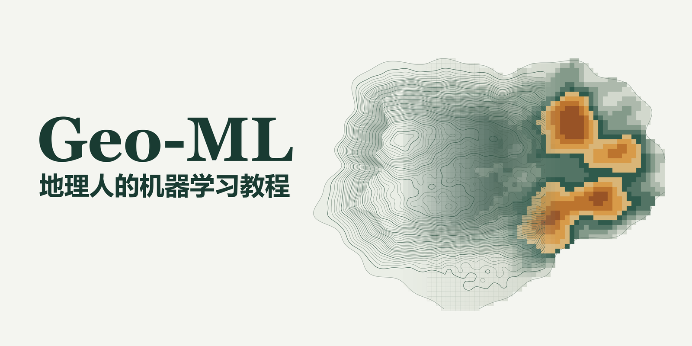
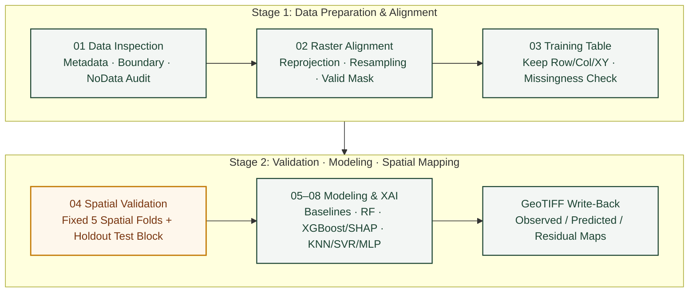

<div align="center">



# Geo-ML | Machine Learning for Geospatial & Remote Sensing

**An end-to-end hands-on workflow with multi-source geographic rasters: Data Audit → Raster Alignment → Modeling → Spatial Cross-Validation → GeoTIFF Write-Back**

[](environment.yml)
[](notebooks/)
[](LICENSE)
[](requirements.txt)

[中文](README.md) · [English](README.en.md)

[Curriculum](#curriculum) · [Core Principles](#core-principles) · [Quick Start](#quick-start) · [Data Guide](docs/DATA.md) · [Environment](docs/ENVIRONMENT.md)

</div>

---

This is a practical, open-source tutorial (written in Chinese in the notebooks) tailored for **Geography, GIS, and Remote Sensing** students and practitioners. You do not need a prior machine learning background: if you know basic Python and are familiar with coordinates, projections, rasters, and pixels, you can follow the 8 Jupyter Notebooks step by step from raw GeoTIFF inspection to spatial prediction mapping.

Rather than chasing leaderboard scores, this course focuses on the real-world geospatial modeling pitfalls that are most often overlooked:

- **Multi-Source Heterogeneous Alignment**: How to rigorously align a 26.7 m UTM DEM, 250 m NDVI, and 5–10 km climate/soil-moisture grids onto a single reference grid.
- **Missing Data & Zero-Padding Traps**: Why undeclared boundary zeros and edge NoData pixels must never be imputed globally before train/test splitting.
- **Spatial Autocorrelation Leakage**: Why random K-fold CV inflates R² and why spatial block validation is essential for honest extrapolation.
- **Boundaries of Explainability**: What SHAP values can—and cannot—tell us when predictors are collinear and observed across different years.

> ⭐ **A Sincere Note (Job Hunting)**: I am currently on the job market. If you find this open-source tutorial helpful for your studies or research, a **Star** on GitHub would mean a lot to my portfolio and motivate me to keep improving it. Thank you!

---

## Course Workflow



---

## Curriculum

> Note: Notebook markdown explanations and code comments are written in Chinese. Each chapter focuses on one core geospatial modeling question with executable code, error analysis, common pitfalls, and exercises.

| Ch. | Notebook | Core Question | Key Methods & Deliverables |
|:---:|---|---|---|
| **01** | [Data Inspection](notebooks/01_认识数据.ipynb) | Can these multi-source rasters be modeled together as-is? | `rasterio` metadata audit, admin boundary check, NoData & zero-padding diagnostics |
| **02** | [Raster Alignment](notebooks/02_栅格对齐.ipynb) | How to align differing CRS and resolutions onto one grid? | Reprojection, bilinear vs. nearest resampling, common valid mask & GeoTIFF export |
| **03** | [Training Table](notebooks/03_构建训练表.ipynb) | How to flatten 2D rasters into a modeling table safely? | Preserving `row/col/x/y`, missingness audit, leakage-free `Pipeline` design |
| **04** | [Spatial Validation](notebooks/04_空间验证.ipynb) | Why are random split scores overly optimistic? | 4-neighbor spatial autocorrelation check, 5 spatial block folds + holdout test region |
| **05** | [Regression Baselines](notebooks/05_回归基线.ipynb) | How far can simple linear baselines go? | Mean baseline, Linear & Ridge regression, spatial triptych (Obs / Pred / Residual) |
| **06** | [Decision Trees & RF](notebooks/06_决策树与随机森林.ipynb) | Why does a single tree overfit and how do forests help? | Tree-depth overfitting curve, Random Forest spatial CV, extrapolation limits |
| **07** | [XGBoost & SHAP](notebooks/07_XGBoost与SHAP.ipynb) | What more can gradient boosting and SHAP reveal? | Spatial CV tuning, Beeswarm & Waterfall plots, collinearity attribution limits |
| **08** | [KNN / SVR / MLP](notebooks/08_KNN_SVR_MLP.ipynb) | How do distance, kernel, and neural models compare? | RBF-SVR parameter heatmap, 4-model comparison, runtime & residual mapping |

---

## Core Principles

1. **Spatial Validation Throughout**: Chapter 04 locks in a fixed split (5 spatial training folds + 1 contiguous south-central holdout test block) reused identically across Chapters 05–08. All tuning happens strictly within spatial folds; the test block is opened only once per finalized model.
2. **Look at Degradation, Not Just Peak CV**: A single deep tree fits the training region closely but degrades sharply on the holdout block; Random Forest and XGBoost degrade much more gracefully across space.
3. **Resampling Does Not Create Detail**: Resampling 5 km precipitation and 10 km soil moisture to a 1 km grid produces piecewise-constant blocks—regional context, not pixel-level local mechanism.
4. **Always Map Your Residuals**: Beyond RMSE, MAE, and R², every modeling chapter maps observations, predictions, and zero-centered residuals side by side to expose spatial error clustering.

---

## Quick Start

### 1. Environment

Geospatial dependencies (GDAL, Rasterio, GeoPandas, PROJ) are best installed via Conda to avoid binary conflicts:

```bash
git clone https://github.com/limi124/Geo-ML.git
cd Geo-ML

# Create the geoml Conda environment (skip if you already have one)
conda env create -f environment.yml
```

> See [docs/ENVIRONMENT.md](docs/ENVIRONMENT.md) and [requirements.txt](requirements.txt) for details.

### 2. Prepare Data

To keep the Git repository lightweight, raw rasters and shapefiles are not hosted directly in the repo. Choose one of three options for `data/raw/`:

- **Option A (Recommended — Full Case Dataset)**: Download the GanNan multi-source rasters and boundary shapefile via Baidu Netdisk and extract them into `data/raw/`:
  - Baidu Netdisk: https://pan.baidu.com/s/14DApydGCLS6j1u2LkQDnaw?pwd=npxd
  - Extraction code: `npxd`

- **Option B (No Download — Synthetic Demo Data)**: Generate a purely mathematical multi-resolution synthetic dataset to run all 8 chapters out of the box:

  ```bash
  conda run -n geoml python tools/make_demo_data.py
  ```

- **Option C (Your Own Data)**: Place identically structured GeoTIFFs and boundary files into `data/raw/` following [docs/DATA.md](docs/DATA.md).

### 3. Register Kernel & Run

```powershell
# 1) Create project-local Jupyter kernelspec (works on Windows / macOS / Linux)
conda run -n geoml python tools/prepare_kernel.py

# 2) Point JUPYTER_PATH to the local kernelspec
# Windows PowerShell:
$env:JUPYTER_PATH = "$PWD\.jupyter"
# macOS / Linux:
# export JUPYTER_PATH="$PWD/.jupyter"

# 3) Run a single chapter or all 8 chapters
conda run --no-capture-output -n geoml python tools/run_notebook.py 01_认识数据.ipynb

conda run --no-capture-output -n geoml python tools/run_notebook.py `
  01_认识数据.ipynb 02_栅格对齐.ipynb 03_构建训练表.ipynb 04_空间验证.ipynb `
  05_回归基线.ipynb 06_决策树与随机森林.ipynb 07_XGBoost与SHAP.ipynb 08_KNN_SVR_MLP.ipynb
```

Generated figures, metric tables, and GeoTIFF predictions are saved under `outputs/`. Before committing, run `conda run -n geoml python tools/check_notebooks.py` to verify repository cleanliness.

---

## Repository Structure

```text
Geo-ML/
├── assets/                 # Cover and social preview graphics
├── notebooks/              # 8 tutorial Notebooks (outputs cleared)
├── src/
│   ├── geoml_data.py       # Raster I/O, alignment, training table, spatial splits
│   ├── geoml_models.py     # Model factories, spatial CV, and metrics
│   └── geoml_style.py      # Map styling, triptychs, and comparison plots
├── tools/
│   ├── make_demo_data.py   # Synthetic multi-source raster generator
│   ├── prepare_kernel.py   # Cross-platform local kernelspec setup
│   ├── run_notebook.py     # Headless notebook runner
│   └── check_notebooks.py  # Repository integrity check
├── data/raw/               # Local data directory (data files git-ignored)
├── docs/
│   ├── DATA.md             # Data preparation & licensing notes
│   └── ENVIRONMENT.md      # Environment & kernel setup
├── environment.yml         # Conda environment specification
└── requirements.txt        # Verified package versions
```

---

## Data & License

- **Code & Tutorial Text**: Released under the [MIT License](LICENSE).
- **Case Dataset & Derived Outputs**: The case study is set in Gannan County, Qiqihar, Heilongjiang (approx. 122.90–124.47°E, 47.59–48.53°N). The accompanying dataset shared via Baidu Netdisk is **for personal learning and methodological demonstration only** and is not covered by the MIT License.

---

## Why I Built This & Related Resources

While learning GIS and remote sensing, I often wished for a practical, end-to-end Chinese tutorial that starts from raw multi-source rasters and rigorously covers spatial validation. I turned my own study notes and exercises into these 8 notebooks so fellow learners can walk through the entire pipeline hands-on.

For deep learning on remote sensing imagery, check out my companion repository: [Remote Sensing Deep Learning Notes (`remote_sensing_dl_notes`)](https://github.com/limi124/remote_sensing_dl_notes).

**If this tutorial helps you, please consider giving the repository a ⭐ Star—it is a huge encouragement to keep maintaining and expanding it!**
