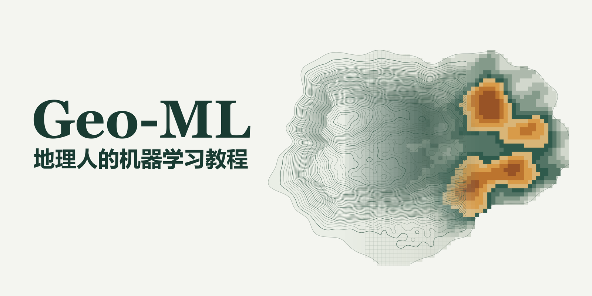
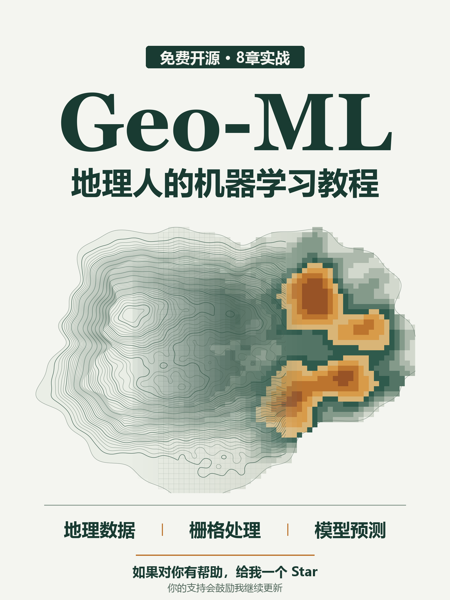

# Geo-ML｜地理人的机器学习课



> 用黑龙江甘南县的多源栅格，走一遍“认数据 → 对齐 → 建模 → 空间验证”的完整流程。

这是一本写给**地理、GIS、遥感方向**读者的中文实战教程。你不需要先学完机器学习：只要有 Python 基础，能看懂经纬度、投影、栅格和像元，就可以跟着 8 个 Notebook 一步步做。

教程不追求“把模型刷到最高分”。它更关心地理人最容易踩的坑：**不同分辨率怎么对齐、缺测怎么处理、随机划分为什么过于乐观、测试区为什么不能反复用、SHAP 为什么不是因果。**

```text
────────────────────────────────────────────────
章节    教程内容
════════════════════════════════════════════════
01      认识遥感栅格与数据质量
02      栅格重投影、重采样与对齐
03      从栅格构建机器学习样本
04      随机划分与空间验证
05      均值基线、线性回归与岭回归
06      决策树与随机森林
07      XGBoost 与 SHAP 模型解释
08      KNN、支持向量回归与 MLP
────────────────────────────────────────────────
```

## 这本书在做什么

案例区是**黑龙江省齐齐哈尔市甘南县**（约 122.90–124.47°E、47.59–48.53°N），不是甘肃省甘南藏族自治州。目标变量是 2021 年的地表温度（LST），预测变量是高程、NDVI、气温、2020 年降水和 2020 年土壤水分。

**本仓库仅供学习与演示。** 欢迎跟着教程动手练习，也欢迎提问、交流和提出改进建议。

## 为什么写这个教程

我学地理与遥感时，常常想找一份能从栅格数据开始、一步步做到模型验证的中文教程。资料并不少，但能跟着实际操作、又把空间验证和数据处理讲清楚的内容不太容易找，有些课程还需要付费。

所以我把自己整理的学习路线和练习，慢慢做成了这 8 章 Notebook。它还在完善中，也不打算用高分结果包装机器学习；我更希望后来想学的地理人，能从数据整理、栅格对齐开始，亲手走完一遍建模和空间验证。

如果你也在学 GIS、遥感或机器学习，欢迎拿它练习。遇到问题、看不懂的地方，或觉得哪一章值得补充，都欢迎开 Issue 告诉我。**我确实很需要 Star 的支持：如果这份教程对你有帮助，请给仓库点一个 Star。对我来说，这不只是一个数字，也是继续整理和完善它的鼓励。**

深度学习内容整理在另一个仓库：[遥感深度学习笔记](https://github.com/limi124/remote_sensing_dl_notes)，也欢迎一起学习交流。

## 你会学到什么

- 从 GeoTIFF 元数据检查、栅格对齐到训练表构建；
- 空间分块验证，以及它和随机划分的区别；
- 从线性回归、树模型到 XGBoost、SHAP、KNN、SVR 和 MLP；
- 用地图和误差指标检查预测表现，并讨论模型解释的边界。



## 案例与数据

教程示例使用黑龙江省齐齐哈尔市甘南县的多源栅格，演示在留出空间区域上估计地表温度。源数据的单位、时间和再分发许可并未全部核实，因此公开仓库不包含原始数据、派生数据或模型结果。请按 [数据说明](docs/DATA.md) 自行准备数据，并先确认你有权使用这些数据。

Notebook 已清除运行输出，公开仓库也不附带原始栅格和边界数据。**克隆仓库后不能直接运行完整案例**：请先按 [数据说明](docs/DATA.md) 准备同结构数据，并确认拥有相应使用权限，再按章节顺序运行以生成自己的表格和图件。

## 快速开始

### 1. 环境

本项目复用已有的 Conda 环境 `geoml`，不新建虚拟环境：

```powershell
conda run -n geoml python --version
```

依赖版本见 [requirements.txt](requirements.txt)。地理库建议通过 Conda 环境安装，避免单独用 pip 安装 GDAL。

### 2. 数据

把六张栅格和甘南县边界放到 `data/raw/`：

```text
data/raw/
├── GNLST.tif
├── GNDEM.tif
├── GNNDVI.tif
├── GNTEM.tif
├── precip_sum_2020.tif
├── soil_moist_mean_2020.tif
└── GanNan.shp / .shx / .dbf / .prj / .cpg
```

字段、单位、时间与校验值见 [docs/DATA.md](docs/DATA.md) 和 [data/raw/README.md](data/raw/README.md)。

### 3. 运行

```powershell
cd Geo-ML

# 生成项目局部 kernelspec（只需一次）
conda run -n geoml python tools\prepare_kernel.py

# 让 Jupyter 找到项目内 kernel
$env:JUPYTER_PATH = "$PWD\.jupyter"

# 跑单章
conda run --no-capture-output -n geoml python tools\run_notebook.py 01_认识数据.ipynb

# 跑全部 8 章
conda run --no-capture-output -n geoml python tools\run_notebook.py `
  01_认识数据.ipynb 02_栅格对齐.ipynb 03_构建训练表.ipynb 04_空间验证.ipynb `
  05_回归基线.ipynb 06_决策树与随机森林.ipynb 07_XGBoost与SHAP.ipynb 08_KNN_SVR_MLP.ipynb
```

每章第一个代码单元都会打印 `sys.executable` 和 `CONDA_PREFIX`，用来确认没有误用 base 环境。

## 项目结构

```text
Geo-ML/
├── notebooks/              # 8 个章节 Notebook（输出已清空）
├── src/
│   ├── geoml_data.py       # 栅格读取、对齐、训练表、空间划分
│   ├── geoml_models.py     # 模型工厂、指标、CV
│   └── geoml_style.py      # 中文制图样式、三联图、模型对比图
├── data/raw/               # 原始数据（不随公开仓库分发）
├── docs/
│   ├── DATA.md             # 数据准备与许可说明
│   └── ENVIRONMENT.md      # 环境配置说明
├── tools/
│   ├── run_notebook.py     # 无界面执行
│   ├── prepare_kernel.py   # 生成本地 kernelspec
│   └── check_notebooks.py  # 交付前自检
└── requirements.txt
```

## 复现与自检

准备好数据后可运行 Notebook。公开版不附带预先生成的结果图和表格。

```powershell
conda run -n geoml python tools\check_notebooks.py
```

教程代码与讲解已在本地数据环境验证。公开版不包含运行所需数据，运行完整教程前请先按数据说明准备并放置数据。

## 数据与许可

**数据再分发许可尚未核实。** 本仓库不分发原始栅格、边界矢量、训练表、预测结果或带运行输出的 Notebook。因此：

- 教程代码与文字采用 MIT 许可（见 [LICENSE](LICENSE)）；
- 数据与模型结果不属于 MIT 许可覆盖范围；
- 使用者需自行确认数据来源和使用权限。

更多信息见 [数据说明](docs/DATA.md)。

## 局限

- 源数据的观测时段、单位和来源信息不完整，不能仅凭数值范围推断。
- 不同变量可能来自不同年份和空间分辨率，不能把重采样误认为增加了细节。
- 测试区与训练区可能存在分布差异，指标需要结合空间划分和误差地图解读。
- 教程的 SVR 网格、树深范围、MLP 结构都很小，目的是教学，不是刷榜。

## 适合谁

- 地理、GIS、遥感专业的本科高年级/研究生；
- 会一点 Python，但没系统做过机器学习的人；
- 想给论文补上“空间验证”“基线模型”“可解释性”的地理工作者。

如果你已经熟悉随机森林和 SHAP，可以直接从第 04、07 章看验证设计和归因边界。

---
